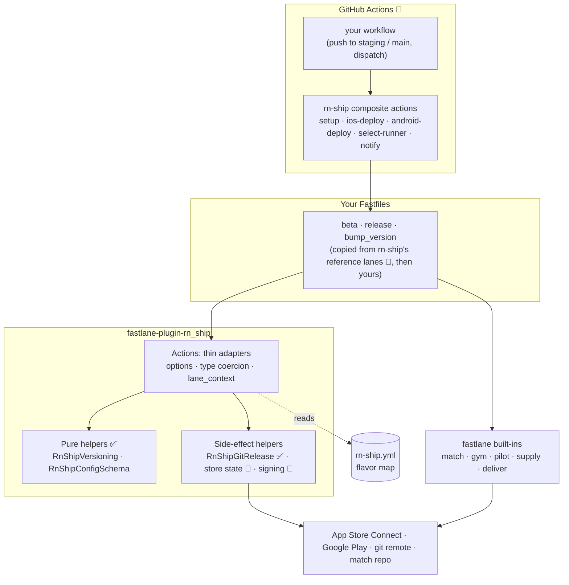
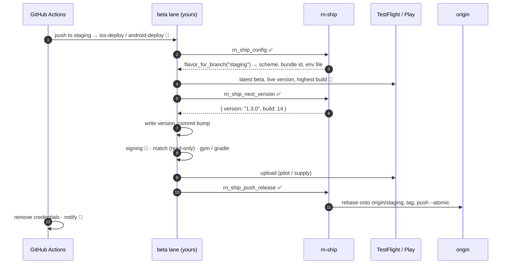
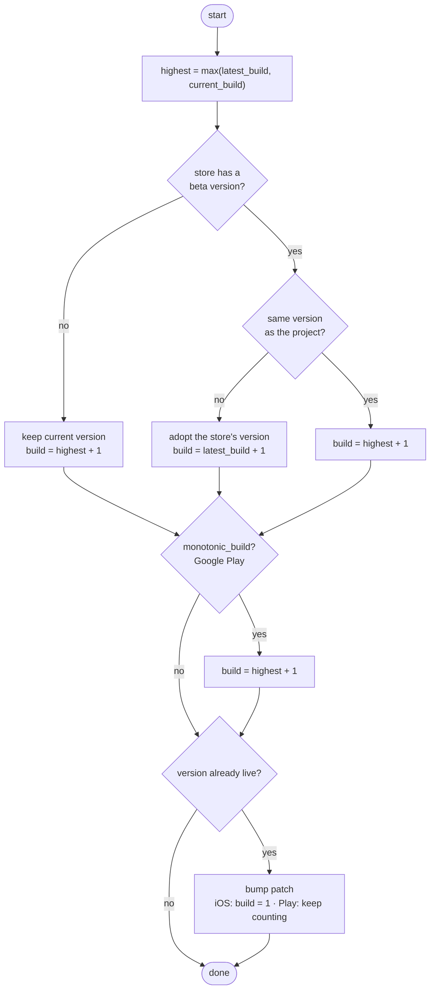
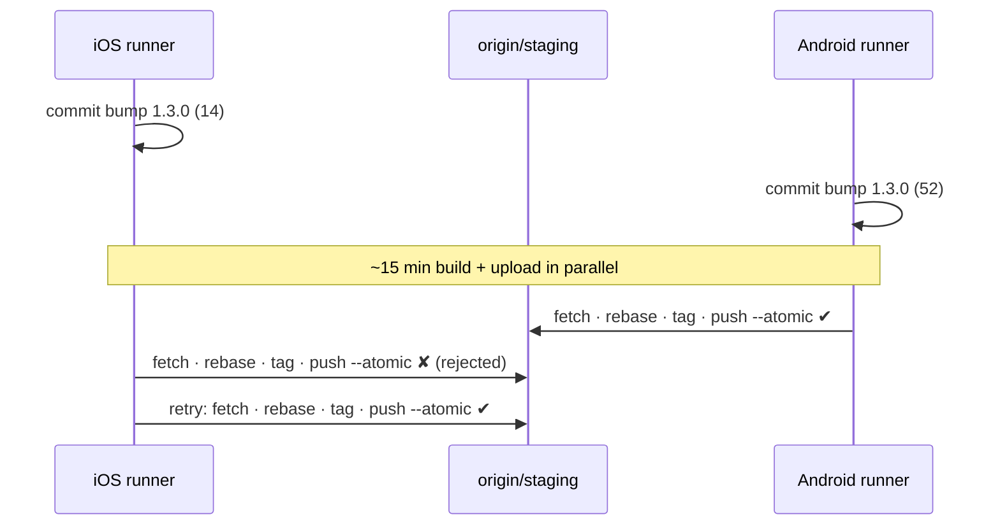
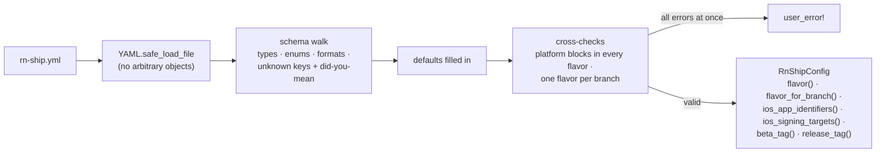

# rn-ship

EAS-style CI/CD for **bare React Native** apps: a fastlane plugin plus GitHub composite actions. No Expo account; it runs on your own CI, GitHub-hosted runners or a self-hosted Mac.

> **Work in progress.** v0.1 is being extracted from the pipeline [Splitify](https://splitify.cc) ships to TestFlight and Google Play with. Each part below is marked ✅ shipped or 🚧 planned.

- [Status](#status)
- [Architecture](#architecture)
  - [Layers](#layers)
  - [Design principles](#design-principles)
  - [Lifecycle of a beta deploy](#lifecycle-of-a-beta-deploy)
  - [Versioning model](#versioning-model)
  - [Release push](#release-push)
  - [Configuration pipeline](#configuration-pipeline)
  - [Security model](#security-model)
  - [Coming from EAS](#coming-from-eas)
  - [Repository layout](#repository-layout)
  - [Testing strategy](#testing-strategy)
  - [Adding an action](#adding-an-action)
- [`rn-ship.yml`](#rn-shipyml)
- [Development](#development)

## Status

| Part | What it does | Status |
|---|---|---|
| `rn_ship_config` | Loads and validates `rn-ship.yml`, reporting every problem with its key path. | ✅ |
| `rn_ship_next_version` | Next version + build number from the store state. The store is the source of truth, a live version gets a patch bump, and `monotonic_build` keeps Play versionCodes counting. | ✅ |
| `rn_ship_push_release` | Rebases the bump commit onto the remote branch, tags it and pushes both with `--atomic`, retrying when the other platform pushed first. | ✅ |
| Store state readers | Reads the latest beta and live versions from TestFlight / App Store, and the internal track, highest versionCode and production release from Google Play. | 🚧 |
| CI signing | A dedicated keychain on self-hosted Macs, read-only match everywhere, signing settings for the app and every extension. | 🚧 |
| Android guards | Refuses to build without the upload key, refuses to ship a debug-signed AAB, pins the env file. Also reads/writes the Gradle version. | 🚧 |
| Play listing | Assembles store copy into a `supply` folder with Play's character limits checked. | 🚧 |
| Reference lanes | `beta`, `release`, `bump_version` Fastfiles you copy and own. | 🚧 |
| GitHub composite actions | `setup`, `ios-deploy`, `android-deploy`, `select-runner`, `notify`. | 🚧 |
| `init` scaffolder | Adds flavors, schemes and configurations to an existing project (`eas build:configure`). | 🚧 phase 2 |

## Architecture

### Layers

rn-ship has four layers. Each one only talks to the layer below it, and each can be adopted on its own: you can call one action from an existing Fastfile without taking anything else.



| Layer | Owns | Never does |
|---|---|---|
| **Config** (`rn-ship.yml`) | *What* exists: flavors, branches, schemes, bundle ids, tag formats, the names of credential env vars. | Hold a secret, or any logic. |
| **Pure helpers** | Decisions: next version, config validation, tag rendering. Plain Ruby, `module_function`, no I/O. | Call the network, git or the shell. |
| **Side-effect helpers** | One narrow job against the outside world: a git push, a store read, a keychain. | Decide policy; they get their inputs from the caller. |
| **Actions** | fastlane's interface: `ConfigItem` options (so `fastlane run` and the CLI coerce types), docs, `lane_context` outputs. | Contain logic beyond wiring a helper. |
| **Lanes** | *The order* of a release: read the store, resolve, build, upload, push. They're yours. | Get hidden inside the plugin. |
| **Composite actions** | Runner setup, writing secrets to disk safely, caching, cleanup, notifications. | Duplicate what a lane already does. |

### Design principles

1. **The store is the source of truth; the branch is a record.** The checked-in version and build number can lag behind what actually shipped, for example when a bump commit failed to push after a successful upload. Every decision starts from what TestFlight or Google Play already has, so a pipeline can't wedge itself on "build number already used".
2. **Pure core, thin shell.** Anything that decides something is a pure function with a table of test cases. The parts that touch the world are small enough to test against a real local equivalent (real git repos, not mocks).
3. **Building blocks plus reference lanes, not a black box.** Release flows differ between teams. rn-ship gives you actions and a set of reference lanes you copy and own, never lanes hidden in a gem. When something goes wrong at 2am, the code that ran is in your repo.
4. **Reuse fastlane; don't wrap it.** match, gym, pilot, supply and deliver are mature. rn-ship adds what they lack for React Native: a flavor map, cross-platform versioning, parallel-safe tagging and guards. It doesn't re-expose their options.
5. **Fail before the build, not after.** A 15-minute build that fails at upload is the most expensive failure there is. The config is validated in full before anything runs, and the guards (upload key, env file, signature) run before or right after the build, never at the store.
6. **iOS and Android deploy in parallel.** Both platforms push to the same branch at the same time. Every git and versioning step assumes the other one exists.
7. **Secrets never touch config or logs.** The config holds the *names* of env vars. Errors about those fields never print the value, in case a real key was pasted there by mistake.
8. **Every message names its fix.** Errors carry a key path, the expected form and, for typos, a suggestion. One run lists every problem.

### Lifecycle of a beta deploy

What happens on a push to `staging`, once the reference lanes and composite actions exist. Each step is marked with what does it today.



The order is deliberate. The version is resolved from the store *before* the build, so the binary carries the right number. The bump commit and its tag are pushed *after* the upload, so a tag always points at something that is really on the store.

### Versioning model

`rn_ship_next_version` takes five facts and returns `{ version:, build: }`:

| Input | iOS source | Android source |
|---|---|---|
| `current_version`, `current_build` | the Xcode project | `versionName` / `versionCode` in `build.gradle` |
| `latest_version`, `latest_build` | the newest TestFlight build | the newest internal-track release; `latest_build` = **highest versionCode on any track** |
| `live_version` | the version live on the App Store | the newest production release (counts while still in review) |



Why each rule exists:

- **The higher build number wins.** On 25 July 2026 Splitify's staging upload of build 13 succeeded, then the bump push failed and left the branch on 12. Trusting the branch recomputed 13, which TestFlight rejected as a duplicate on every following run. Taking the maximum makes the pipeline heal itself.
- **Adopt the store's version.** The store is where the release train is. A branch that's behind (an old merge) or ahead (a local bump that never shipped) defers to it.
- **The closed train gets a patch bump.** Apple and Google both refuse new builds for a version that is already live, so rn-ship moves to the next patch on its own.
- **Play is monotonic.** A versionCode can never be reused on *any* track, so on Android the build number never resets, not even on a new version.

Every rule is a scenario in [`spec/versioning_spec.rb`](spec/versioning_spec.rb).

### Release push

`rn_ship_push_release` solves one race: the build and upload take 15+ minutes, and meanwhile the branch moves on. Developers push, someone commits a `[skip ci]` metadata edit, and the *other platform* pushes its own bump commit.



| Step | Why |
|---|---|
| `git checkout -- :/` | The build rewrites tracked files (signing settings in `project.pbxproj`) after the bump commit, and git refuses to rebase a dirty tree. Those edits must never reach the branch, so they're discarded rather than stashed. `:/` covers the whole repo, even though fastlane runs from `ios/` or `android/`. |
| rebase, not merge | Keeps the branch linear: one bump commit per upload. |
| tag **after** the rebase | The rebase rewrites the commit, so a tag made earlier would point at a commit that never reaches the branch. |
| `push --atomic` branch + tag | Either both land or neither does. You never get a tag without its commit, or a commit whose tag is missing. |
| retry a rejected push (default 3) | A rejection means someone pushed in between. Fetching and rebasing again fixes it. |
| **don't** retry a rebase conflict | A conflict means two changes to the same lines (usually two bumps of the same file), and that needs a human. The rebase is aborted so the runner's checkout is left clean. |

### Configuration pipeline



- **Lookup order:** the `path:` option, then `RN_SHIP_CONFIG`, then the nearest `rn-ship.yml` above the current directory. fastlane runs from `ios/` or `android/`; the file lives at the repo root.
- **Paths** inside the file are relative to the file, and `config.expand(path)` resolves them.
- **IDs written unquoted** (`itc_team_id: 121080038` parses as an Integer) are coerced to strings.
- **Tag templates** may only use `{version}`, `{build}`, `{flavor}` and `{platform}`, and they must contain `{build}` so every upload gets its own tag.
- **The schema** is a single plain hash in [`config_schema.rb`](lib/fastlane/plugin/rn_ship/helper/config_schema.rb). It's both the validator and the reference for every key and default.

An invalid file reports everything in one go:

```
rn-ship.yml is invalid:
  - andriod is not a known key (did you mean android?)
  - ios.workspace is required
  - ios.extensions[0].bundle_id_suffix must be a suffix starting with a dot, e.g. .NotificationService, got "Notif"
  - ios.app_store_connect.key_id_env must be the NAME of an environment variable, never the secret itself, got a value that isn't one (not shown)
  - flavors.staging.tags.ios uses unknown placeholder {sha} (known: {version} {build} {flavor} {platform})
```

### Security model

| Threat | Mitigation | Status |
|---|---|---|
| Secret committed in config | The config only accepts env var *names* (`/\A[A-Z_][A-Z0-9_]*\z/`). Anything else fails validation. | ✅ |
| Secret echoed into CI logs | Errors on credential fields never print the value (only its type, for non-strings). | ✅ |
| Secret expanded by the shell | Composite actions write secrets through `env:` + `printf`, never `${{ secrets.X }}` inside `run:`, where `$`, backticks and quotes in the value are expanded. | 🚧 |
| CI creating or revoking certificates | match runs `readonly` on every CI runner, not just self-hosted ones. | 🚧 |
| Taking over a developer's login keychain (self-hosted Mac) | A dedicated non-default keychain with a random password, first in the search list, deleted in `after_all` / `error`. Archives go to `$RUNNER_TEMP`. | 🚧 |
| Credentials left on a persistent runner | Cleanup with `if: always()` removes keys, env files, the generated `.env` and `ios/tmp.xcconfig`. | 🚧 |
| Shipping a debug-signed AAB | The upload key is required, and the AAB's SHA-256 is compared against the debug keystore before upload. The first AAB permanently enrolls its key on Play. | 🚧 |
| Build-only keys inside the app | react-native-config compiles *every* key of the env file into the app. Keep CI credentials out of `.env.*` files and in CI env vars. | documented |

### Coming from EAS

| EAS | rn-ship |
|---|---|
| `eas.json` build profiles | `rn-ship.yml` flavors |
| `autoIncrement` / remote version source | `rn_ship_next_version` from store state |
| Managed credentials | match (iOS), upload keystore secrets + guards (Android) |
| `eas build` + `eas submit` | `beta` lane: TestFlight / Play internal track |
| Submit for review / promote | `release` lane: `deliver` review / Play promotion |
| `eas build:configure` | `init` scaffolder (phase 2) |
| EAS Update, build cache | Out of scope. Pair with [Rock](https://www.rockjs.dev)'s remote build cache rather than rebuilding it. |

### Repository layout

```
rn-ship/
├── fastlane-plugin-rn_ship.gemspec
├── lib/fastlane/plugin/
│   ├── rn_ship.rb                     # plugin entry: loads every action and helper
│   └── rn_ship/
│       ├── version.rb
│       ├── helper/
│       │   ├── versioning.rb          # ✅ pure: bump_semver, resolve_next_version
│       │   ├── config_schema.rb       # ✅ pure: SCHEMA + validator
│       │   ├── config.rb              # ✅ RnShipConfig: loading, lookups, tags
│       │   └── git_release.rb         # ✅ push_release
│       └── actions/
│           ├── rn_ship_config.rb      # ✅
│           ├── rn_ship_next_version.rb# ✅
│           └── rn_ship_push_release.rb# ✅
├── spec/                              # ✅ RSpec, fixtures/splitify.yml
├── templates/                         # 🚧 reference Fastfiles
├── actions/                           # 🚧 GitHub composite actions
├── scripts/ci-runner.sh               # 🚧 self-hosted Mac runner manager
└── example/                           # 🚧 RN CLI app with dev/staging/prod
```

The gem and the GitHub actions share one repo and one version tag, so `fastlane-plugin-rn_ship 0.1.0` and `uses: 27AppStudio/rn-ship/actions/ios-deploy@v0.1.0` always match.

### Testing strategy

| Level | How | Example |
|---|---|---|
| Pure logic | A table of real scenarios, one example each | 13 resolver scenarios + edge cases, 7 semver bumps |
| Side effects | Against the real thing, locally: temporary bare git repos, a `pre-receive` hook that rejects the first N pushes, a second clone acting as "the other platform" | rebase onto a concurrent push, retry, give up, conflict abort |
| Action wiring | A real lane parsed by `Fastlane::FastFile`, so option parsing, defaults and `lane_context` are exercised | `rn_ship_next_version`, `rn_ship_config` |
| Plugin loading | `fastlane run …` from a project with a `Pluginfile`, the way a consumer loads it | manual, before each release |
| Real-world config | Splitify's actual setup as a fixture (irregular schemes, an app extension, custom tags) | `spec/fixtures/splitify.yml` |

CI runs the suite on Ruby 3.1 and 3.4.

### Adding an action

1. Put the logic in a helper under `helper/`. If it decides something, make it a pure `module_function` with keyword arguments. If it touches the world, keep it to one job and have it take its inputs.
2. Wrap it in `actions/rn_ship_<name>.rb`: `ConfigItem` options with types, `description`, `details`, `example_code`, outputs in `lane_context`. No logic.
3. Read flavors, ids and env var names from `RnShipConfig`. Never hardcode a project name or a credential name.
4. Spec the helper with a table of cases. Spec side effects against a real local equivalent, and the action through `run_lane`.

## `rn-ship.yml`

The `eas.json` of a bare project, at the repo root. It maps each flavor to a branch, an env file, an iOS scheme/configuration/bundle id and a Gradle flavor/package name. Credentials are referenced by **environment variable name** only; the defaults are fastlane's own (`APP_STORE_CONNECT_API_KEY_*`, `SUPPLY_JSON_KEY_DATA`).

```yaml
ios:
  project: ios/MyApp.xcodeproj
  workspace: ios/MyApp.xcworkspace
  target: MyApp
  team_id: ABCDE12345
  match: { git_url: git@github.com:me/certificates.git }
  extensions:
    - { target: NotificationService, bundle_id_suffix: .NotificationService }

android:
  upload_key_prefix: MYAPP_UPLOAD   # MYAPP_UPLOAD_STORE_FILE, _STORE_PASSWORD, _KEY_ALIAS, _KEY_PASSWORD

flavors:
  staging:
    branch: staging
    env_file: .env.staging
    ios: { scheme: staging, configuration: StagingRelease, bundle_id: com.example.myapp.staging }
    android: { flavor: staging, package_name: com.example.myapp.staging }
  production:
    branch: main
    env_file: .env.production
    ios: { scheme: MyApp, configuration: Release, bundle_id: com.example.myapp }
    android: { flavor: production, package_name: com.example.myapp }
```

| Key | Default |
|---|---|
| `ios.match.type` | `appstore` |
| `ios.app_store_connect.*_env` | `APP_STORE_CONNECT_API_KEY_KEY_ID`, `_ISSUER_ID`, `_KEY`, `_KEY_FILEPATH` |
| `android.project_dir` / `gradle_file` | `android` / `android/app/build.gradle` |
| `android.play.json_key_env` | `SUPPLY_JSON_KEY_DATA` |
| `android.play.track` | `internal` |
| `flavors.*.android.build_type` | `Release` |
| `flavors.*.tags.ios` / `.android` | `v{version}-ios-{flavor}.{build}` / `v{version}-android-{flavor}.{build}` |
| `release_tags.ios` / `.android` | `v{version}-ios-{build}` / `v{version}-android-{build}` |
| `ci.self_hosted_env` / `ci.keychain` | `RN_SHIP_SELF_HOSTED` / `rn_ship_ci` |

[`spec/fixtures/splitify.yml`](spec/fixtures/splitify.yml) is a complete real-world example.

## Development

```sh
bundle install
bundle exec rspec
```

## License

MIT
