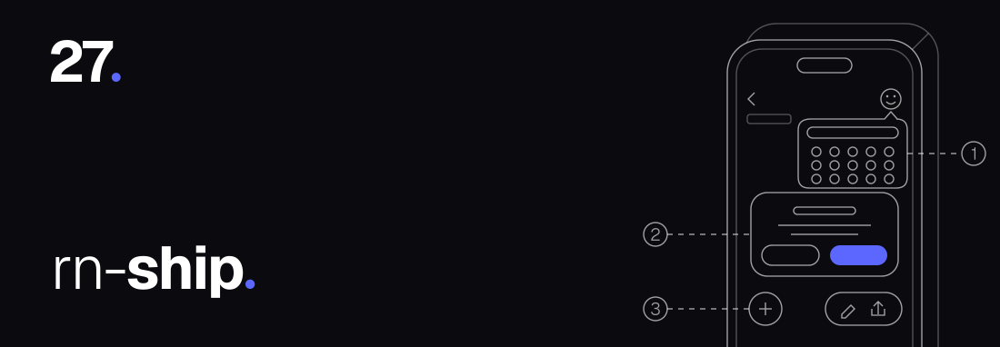

<h1></h1>

<p>
  <a href="https://github.com/27AppStudio/rn-ship/actions/workflows/ci.yml"></a>
  <a href="#status"></a>
  <a href="LICENSE"></a>
</p>

EAS-style CI/CD for **bare React Native** apps: a fastlane plugin plus GitHub composite actions. No Expo account; it runs on your own CI, GitHub-hosted runners or a self-hosted Mac.

> **Work in progress.** v0.1 is being extracted from the pipeline [Splitify](https://splitify.cc) ships to TestFlight and Google Play with. Each part below is marked shipped or planned. Design and reference docs live in [`docs/`](docs/): [architecture](docs/architecture.md), [configuration](docs/configuration.md), [security](docs/security.md), [testing](docs/testing.md).

## Status

| Part | What it does | Status |
|---|---|---|
| `rn_ship_config` | Loads and validates `rn-ship.yml`, reporting every problem with its key path. | Shipped |
| `rn_ship_next_version` | Next version + build number from the store state. The store is the source of truth, a live version gets a patch bump, and `monotonic_build` keeps Play versionCodes counting. | Shipped |
| `rn_ship_push_release` | Rebases the bump commit onto the remote branch, tags it and pushes both with `--atomic`, retrying when the other platform pushed first. | Shipped |
| `rn_ship_store_state` | Reads what the store already has for a flavor: latest TestFlight build and live App Store version, or Play's beta track, highest versionCode on any track and live production release. Returns exactly the inputs of `rn_ship_next_version`. Read-only. | Shipped |
| `rn_ship_ios_preflight` | Before match and the archive: checks every target, the configuration and the shared scheme against the real Xcode project, refuses a stale `/tmp/envfile`, pins `ENVFILE`, and requires the App Store Connect key. | Shipped |
| `rn_ship_ci_signing` / `rn_ship_ci_signing_cleanup` | CI keychain: fastlane's `setup_ci` on hosted runners, a dedicated non-default keychain on self-hosted Macs (deleted afterwards), match read-only on every path. | Shipped |
| `rn_ship_ios_signing` | Writes team, identity, match profile and bundle id into the app and every extension for the flavor's configuration. The checked-in project isn't trusted. | Shipped |
| `rn_ship_android_preflight` | Before the build: refuses to start without the upload key properties and keystore, and pins `ENVFILE` to the flavor's env file. | Shipped |
| `rn_ship_verify_aab` | After the build: refuses to ship a bundle that isn't signed with exactly the upload key, and names the debug keystore when that's the culprit. | Shipped |
| `rn_ship_gradle_version` | Reads / writes `versionName` and `versionCode` in `build.gradle(.kts)`, refusing per-flavor overrides that would keep their own value. | Shipped |
| `rn_ship_xcode_version` | Reads / writes the version and build number of the app and every extension, in build settings and literal Info.plist values. No agvtool. | Shipped |
| Play listing | Assembles store copy into a `supply` folder with Play's character limits checked. | Planned |
| Reference lanes | [`templates/fastlane/Fastfile`](templates/fastlane/Fastfile): `ios` / `android` `beta` and `release`, built from the actions above. You copy it and own it. | Shipped |
| GitHub composite actions | `setup`, `ios-deploy`, `android-deploy`, `notify`, and an [example workflow](examples/deploy.yml). | Shipped |
| Self-hosted runner tooling | `select-runner` (use a self-hosted Mac when it's online, GitHub-hosted otherwise) and a runner manager script. | Planned |
| `init` scaffolder | Adds flavors, schemes and configurations to an existing project (`eas build:configure`). | Planned (phase 2) |

## Getting started

1. **Configure flavors** in your project first (schemes and configurations in Xcode, `productFlavors` in Gradle, one env file each). rn-ship reads them; it doesn't create them yet.
2. **Add `rn-ship.yml`** at the repo root ([reference](docs/configuration.md)).
3. **Add fastlane and the plugin** from [`templates/`](templates): `Gemfile` at the root, `fastlane/Pluginfile`, and `fastlane/Fastfile` (the reference lanes, yours to change).
4. **Try it locally**, read-only first: `bundle exec fastlane run rn_ship_config` validates the file, then `bundle exec fastlane ios beta flavor:staging` from a machine that can sign.
5. **Add the workflow**: copy [`examples/deploy.yml`](examples/deploy.yml) to `.github/workflows/` and add the secrets below.

| Secret | Used by | What |
|---|---|---|
| `APP_STORE_CONNECT_KEY_ID`, `APP_STORE_CONNECT_ISSUER_ID`, `APP_STORE_CONNECT_KEY` | `ios-deploy` | An App Store Connect API key; the last one is the `.p8` file's content |
| `MATCH_PASSWORD`, `MATCH_SSH_KEY` | `ios-deploy` | match's passphrase, and a deploy key for the certificates repo when it's cloned over SSH |
| `ANDROID_UPLOAD_KEYSTORE_BASE64`, `ANDROID_UPLOAD_STORE_PASSWORD`, `ANDROID_UPLOAD_KEY_ALIAS`, `ANDROID_UPLOAD_KEY_PASSWORD` | `android-deploy` | The Play upload key (`base64 -i upload.jks`) |
| `PLAY_SERVICE_ACCOUNT_JSON` | `android-deploy` | A Google Play service account key with release permissions |
| `ENV_STAGING`, `ENV_PRODUCTION` | both | Env file contents, when they aren't committed |
| `DEPLOY_WEBHOOK` | `notify` | Optional Discord or Slack incoming webhook |

The actions export each secret under the env var name `rn-ship.yml` gives it, so the lanes and the workflow never disagree. The bump commit and tag are pushed with the workflow's `GITHUB_TOKEN` (`permissions: contents: write`); a branch protection rule on a flavor branch must let it push.

## Configuration

`rn-ship.yml` at the repo root is the `eas.json` of a bare project: each flavor's branch, env file, iOS scheme/configuration/bundle id and Gradle flavor/package name. Credentials are referenced by env var name only.

```yaml
ios:
  project: ios/MyApp.xcodeproj
  workspace: ios/MyApp.xcworkspace
  target: MyApp
  team_id: ABCDE12345
  match: { git_url: git@github.com:me/certificates.git }
  extensions:
    - { target: NotificationService, bundle_id_suffix: .NotificationService }

android:
  upload_key_prefix: MYAPP_UPLOAD   # MYAPP_UPLOAD_STORE_FILE, _STORE_PASSWORD, _KEY_ALIAS, _KEY_PASSWORD

flavors:
  staging:
    branch: staging
    env_file: .env.staging
    ios: { scheme: staging, configuration: StagingRelease, bundle_id: com.example.myapp.staging }
    android: { flavor: staging, package_name: com.example.myapp.staging }
  production:
    branch: main
    env_file: .env.production
    ios: { scheme: MyApp, configuration: Release, bundle_id: com.example.myapp }
    android: { flavor: production, package_name: com.example.myapp }
```

Every key, its default, how the file is validated, and the Android upload-key setup: [docs/configuration.md](docs/configuration.md).

## Coming from EAS

| EAS | rn-ship |
|---|---|
| `eas.json` build profiles | `rn-ship.yml` flavors |
| `autoIncrement` / remote version source | `rn_ship_next_version` from store state |
| Managed credentials | match (iOS), upload keystore secrets + guards (Android) |
| `eas build` + `eas submit` | `beta` lane: TestFlight / Play internal track |
| Submit for review / promote | `release` lane: `deliver` review / Play promotion |
| `eas build:configure` | `init` scaffolder (phase 2) |
| EAS Workflows | [`examples/deploy.yml`](examples/deploy.yml) with the composite actions |
| EAS Update, build cache | Out of scope. Pair with [Rock](https://www.rockjs.dev)'s remote build cache rather than rebuilding it. |

## Documentation

| Doc | What's in it |
|---|---|
| [Architecture](docs/architecture.md) | Layers and their contracts, design principles, the lifecycle of a deploy, the versioning model, the parallel-safe release push, repository layout, adding an action |
| [Configuration](docs/configuration.md) | `rn-ship.yml` reference and defaults, how it's loaded and validated, the Android upload key |
| [Security](docs/security.md) | What can leak or go wrong in a mobile release pipeline, and what rn-ship does about each |
| [Testing](docs/testing.md) | How each layer is tested, and running the suite |

## Development

```sh
bundle install
bundle exec rspec
```

## License

MIT

## Made by 27AppStudio

<p>
  <a href="https://27appstudio.com">
    <picture>
      <source media="(prefers-color-scheme: dark)" srcset="docs/images/27appstudio-on-dark.svg">
      
    </picture>
  </a>
</p>

An independent French mobile app studio. We design, build and launch iPhone and Android apps, and open-source the native pieces we make along the way, most of them for [Splitify](https://splitify.cc).

| Library | What it does |
|---|---|
| [react-native-alert](https://github.com/27AppStudio/react-native-alert) | Native alerts and text prompts in your app's colors |
| [react-native-bottom-toolbar](https://github.com/27AppStudio/react-native-bottom-toolbar) | The platform's own bottom toolbar: UIKit on iOS, Material 3 on Android |
| [react-native-emoji-picker](https://github.com/27AppStudio/react-native-emoji-picker) | A native emoji picker: iOS popover, Material 3 bottom sheet |
| [rn-ship](https://github.com/27AppStudio/rn-ship) | EAS-style release pipeline for bare React Native apps |

Need an app built, or a hand with a React Native one? [27appstudio.com](https://27appstudio.com)
