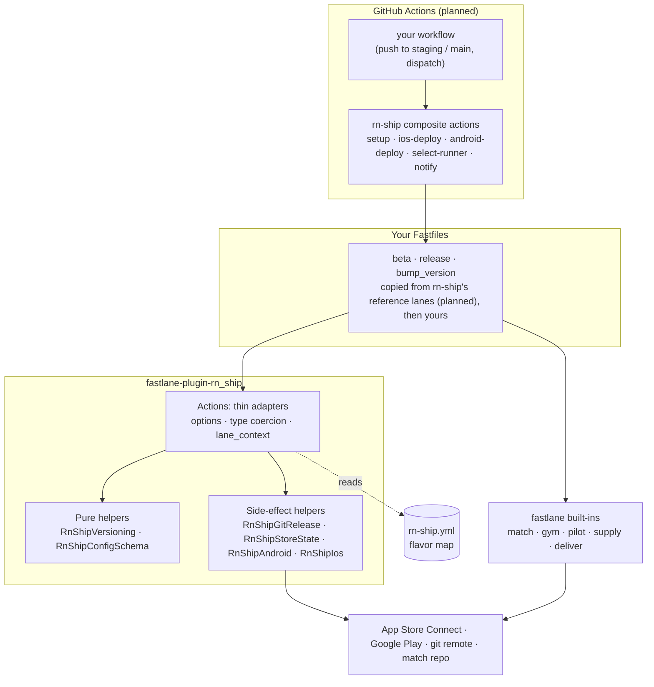
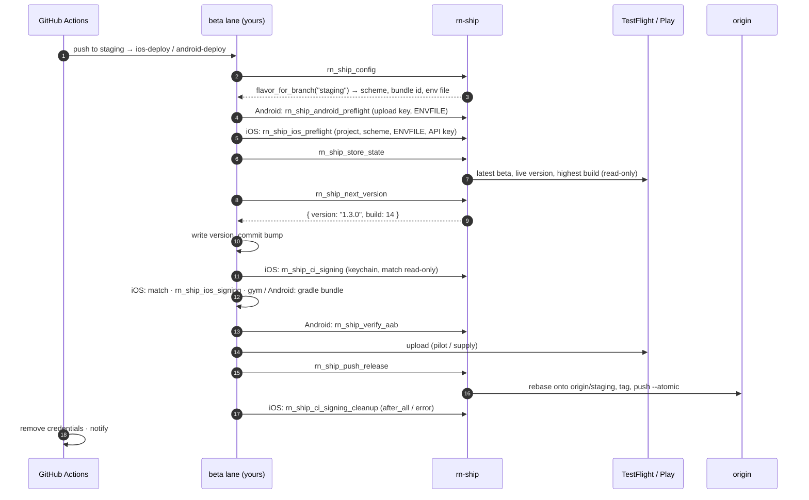
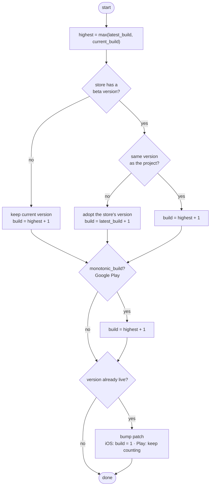
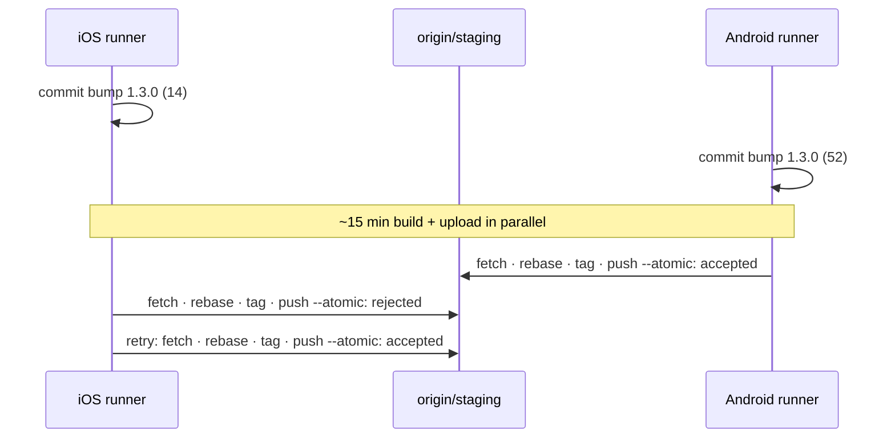

# Architecture

[README](../README.md) · [Architecture](architecture.md) · [Configuration](configuration.md) · [Security](security.md) · [Testing](testing.md)

How rn-ship is put together and why. For the config file see [Configuration](configuration.md); for credentials and runners see [Security](security.md).

## Layers

rn-ship has four layers. Each one only talks to the layer below it, and each can be adopted on its own: you can call one action from an existing Fastfile without taking anything else.



| Layer | Owns | Never does |
|---|---|---|
| **Config** (`rn-ship.yml`) | *What* exists: flavors, branches, schemes, bundle ids, tag formats, the names of credential env vars. | Hold a secret, or any logic. |
| **Pure helpers** | Decisions: next version, config validation, tag rendering. Plain Ruby, `module_function`, no I/O. | Call the network, git or the shell. |
| **Side-effect helpers** | One narrow job against the outside world: a git push, a store read, a keychain. | Decide policy; they get their inputs from the caller. |
| **Actions** | fastlane's interface: `ConfigItem` options (so `fastlane run` and the CLI coerce types), docs, `lane_context` outputs. | Contain logic beyond wiring a helper. |
| **Lanes** | *The order* of a release: read the store, resolve, build, upload, push. They're yours. | Get hidden inside the plugin. |
| **Composite actions** | Runner setup, writing secrets to disk safely, caching, cleanup, notifications. | Duplicate what a lane already does. |

## Design principles

1. **The store is the source of truth; the branch is a record.** The checked-in version and build number can lag behind what actually shipped, for example when a bump commit failed to push after a successful upload. Every decision starts from what TestFlight or Google Play already has, so a pipeline can't wedge itself on "build number already used".
2. **Pure core, thin shell.** Anything that decides something is a pure function with a table of test cases. The parts that touch the world are small enough to test against a real local equivalent (real git repos, not mocks).
3. **Building blocks plus reference lanes, not a black box.** Release flows differ between teams. rn-ship gives you actions and a set of reference lanes you copy and own, never lanes hidden in a gem. When something goes wrong at 2am, the code that ran is in your repo.
4. **Reuse fastlane; don't wrap it.** match, gym, pilot, supply and deliver are mature. rn-ship adds what they lack for React Native: a flavor map, cross-platform versioning, parallel-safe tagging and guards. It doesn't re-expose their options.
5. **Fail before the build, not after.** A 15-minute build that fails at upload is the most expensive failure there is. The config is validated in full before anything runs, and the guards (upload key, env file, signature) run before or right after the build, never at the store.
6. **iOS and Android deploy in parallel.** Both platforms push to the same branch at the same time. Every git and versioning step assumes the other one exists.
7. **Secrets never touch config or logs.** The config holds the *names* of env vars. Errors about those fields never print the value, in case a real key was pasted there by mistake.
8. **Every message names its fix.** Errors carry a key path, the expected form and, for typos, a suggestion. One run lists every problem.

## Lifecycle of a beta deploy

What happens on a push to `staging`, once the reference lanes and composite actions exist. Steps marked (planned) don't exist yet.



The order is deliberate. The preflight runs first, so a missing upload key or env file fails the job before anything is committed. The version is resolved from the store *before* the build, so the binary carries the right number. The bump commit and its tag are pushed *after* the upload, so a tag always points at something that is really on the store.

## Versioning model

`rn_ship_next_version` takes five facts and returns `{ version:, build: }`:

| Input | iOS source | Android source |
|---|---|---|
| `current_version`, `current_build` | the Xcode project | `versionName` / `versionCode` in `build.gradle` |
| `latest_version`, `latest_build` | the newest TestFlight build | the newest internal-track release; `latest_build` = **highest versionCode on any track** |
| `live_version` | the version live on the App Store | the newest production release (counts while still in review) |

`rn_ship_store_state` reads all of these and returns them in that shape, so a lane is two calls:

```ruby
store = rn_ship_store_state(flavor: "staging")      # platform comes from the lane
next_version = rn_ship_next_version(current_version: "1.3.0", current_build: 12, **store)
```

Two details matter here:

- **"Nothing live" is not an error.** fastlane's `latest_testflight_build_number(live: true)` raises when no version is live, the same way it raises for an expired API key. A lane that rescues the first silently rescues the second, then skips the patch bump the store requires. rn-ship asks Spaceship directly, so "nothing live" is `nil` and a real failure still fails.
- **A new app has no build 0.** fastlane reports a missing TestFlight build as build 1 by default. rn-ship passes `initial_build_number: 0`, so "nothing uploaded yet" and "build 1 uploaded" stay different.



Why each rule exists:

- **The higher build number wins.** On 25 July 2026 Splitify's staging upload of build 13 succeeded, then the bump push failed and left the branch on 12. Trusting the branch recomputed 13, which TestFlight rejected as a duplicate on every following run. Taking the maximum makes the pipeline heal itself.
- **Adopt the store's version.** The store is where the release train is. A branch that's behind (an old merge) or ahead (a local bump that never shipped) defers to it.
- **The closed train gets a patch bump.** Apple and Google both refuse new builds for a version that is already live, so rn-ship moves to the next patch on its own.
- **Play is monotonic.** A versionCode can never be reused on *any* track, so on Android the build number never resets, not even on a new version.

Every rule is a scenario in [`spec/versioning_spec.rb`](../spec/versioning_spec.rb).

## Release push

`rn_ship_push_release` solves one race: the build and upload take 15+ minutes, and meanwhile the branch moves on. Developers push, someone commits a `[skip ci]` metadata edit, and the *other platform* pushes its own bump commit.



| Step | Why |
|---|---|
| `git checkout -- :/` | The build rewrites tracked files (signing settings in `project.pbxproj`) after the bump commit, and git refuses to rebase a dirty tree. Those edits must never reach the branch, so they're discarded rather than stashed. `:/` covers the whole repo, even though fastlane runs from `ios/` or `android/`. |
| rebase, not merge | Keeps the branch linear: one bump commit per upload. |
| tag **after** the rebase | The rebase rewrites the commit, so a tag made earlier would point at a commit that never reaches the branch. |
| `push --atomic` branch + tag | Either both land or neither does. You never get a tag without its commit, or a commit whose tag is missing. |
| retry a rejected push (default 3) | A rejection means someone pushed in between. Fetching and rebasing again fixes it. |
| **don't** retry a rebase conflict | A conflict means two changes to the same lines (usually two bumps of the same file), and that needs a human. The rebase is aborted so the runner's checkout is left clean. |

## Repository layout

```
rn-ship/
├── fastlane-plugin-rn_ship.gemspec
├── lib/fastlane/plugin/
│   ├── rn_ship.rb                     # plugin entry: loads every action and helper
│   └── rn_ship/
│       ├── version.rb
│       ├── helper/
│       │   ├── versioning.rb          # pure: bump_semver, resolve_next_version
│       │   ├── config_schema.rb       # pure: SCHEMA + validator
│       │   ├── config.rb              # RnShipConfig: loading, lookups, tags
│       │   ├── git_release.rb         # push_release
│       │   ├── store_state.rb         # App Store Connect / Play reads; pure Play track summary
│       │   ├── android.rb             # upload key, signature, ENVFILE, Gradle version
│       │   └── ios.rb                 # project checks, keychain order, identities
│       └── actions/
│           ├── rn_ship_config.rb
│           ├── rn_ship_next_version.rb
│           ├── rn_ship_push_release.rb
│           ├── rn_ship_store_state.rb
│           ├── rn_ship_android_preflight.rb
│           ├── rn_ship_verify_aab.rb
│           ├── rn_ship_gradle_version.rb
│           ├── rn_ship_ios_preflight.rb
│           ├── rn_ship_ios_signing.rb
│           └── rn_ship_ci_signing.rb  # rn_ship_ci_signing + rn_ship_ci_signing_cleanup
├── spec/                              # RSpec, fixtures/splitify.yml
├── templates/                         # Gemfile, fastlane/Pluginfile, fastlane/Fastfile (reference lanes)
├── actions/
│   ├── setup/ ios-deploy/ android-deploy/ notify/   # composite actions
│   └── scripts/                       # their logic: write-secret, cleanup, notify, credential-names
├── examples/deploy.yml                # the workflow to copy
├── scripts/ci-runner.sh               # planned: self-hosted Mac runner manager
└── example/                           # planned: RN CLI app with dev/staging/prod
```

The gem and the GitHub actions share one repo and one version tag, so `fastlane-plugin-rn_ship 0.1.0` and `uses: 27AppStudio/rn-ship/actions/ios-deploy@v0.1.0` always match.

## Adding an action

1. Put the logic in a helper under `helper/`. If it decides something, make it a pure `module_function` with keyword arguments. If it touches the world, keep it to one job and have it take its inputs.
2. Wrap it in `actions/rn_ship_<name>.rb`: `ConfigItem` options with types, `description`, `details`, `example_code`, outputs in `lane_context`. No logic.
3. Read flavors, ids and env var names from `RnShipConfig`. Never hardcode a project name or a credential name.
4. Spec the helper with a table of cases. Spec side effects against a real local equivalent, and the action through `run_lane`.
