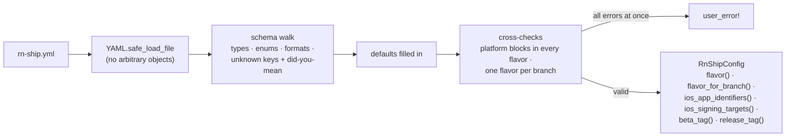

# Configuration

[README](../README.md) · [Architecture](architecture.md) · [Configuration](configuration.md) · [Security](security.md) · [Testing](testing.md)

## Format

The `eas.json` of a bare project, at the repo root. It maps each flavor to a branch, an env file, an iOS scheme/configuration/bundle id and a Gradle flavor/package name. Credentials are referenced by **environment variable name** only; the defaults are fastlane's own (`APP_STORE_CONNECT_API_KEY_*`, `SUPPLY_JSON_KEY_DATA`).

```yaml
ios:
  project: ios/MyApp.xcodeproj
  workspace: ios/MyApp.xcworkspace
  target: MyApp
  team_id: ABCDE12345
  match: { git_url: git@github.com:me/certificates.git }
  extensions:
    - { target: NotificationService, bundle_id_suffix: .NotificationService }

android:
  upload_key_prefix: MYAPP_UPLOAD   # MYAPP_UPLOAD_STORE_FILE, _STORE_PASSWORD, _KEY_ALIAS, _KEY_PASSWORD

flavors:
  staging:
    branch: staging
    env_file: .env.staging
    ios: { scheme: staging, configuration: StagingRelease, bundle_id: com.example.myapp.staging }
    android: { flavor: staging, package_name: com.example.myapp.staging }
  production:
    branch: main
    env_file: .env.production
    ios: { scheme: MyApp, configuration: Release, bundle_id: com.example.myapp }
    android: { flavor: production, package_name: com.example.myapp }
```

| Key | Default |
|---|---|
| `ios.match.type` | `appstore` |
| `ios.app_store_connect.*_env` | `APP_STORE_CONNECT_API_KEY_KEY_ID`, `_ISSUER_ID`, `_KEY`, `_KEY_FILEPATH` |
| `android.project_dir` / `gradle_file` | `android` / `android/app/build.gradle` |
| `android.play.json_key_env` | `SUPPLY_JSON_KEY_DATA` |
| `android.play.track` | `internal` |
| `flavors.*.android.build_type` | `Release` |
| `flavors.*.tags.ios` / `.android` | `v{version}-ios-{flavor}.{build}` / `v{version}-android-{flavor}.{build}` |
| `release_tags.ios` / `.android` | `v{version}-ios-{build}` / `v{version}-android-{build}` |
| `ci.self_hosted_env` / `ci.keychain` | `RN_SHIP_SELF_HOSTED` / `rn_ship_ci` |

[`spec/fixtures/splitify.yml`](../spec/fixtures/splitify.yml) is a complete real-world example.

## Android upload key

`upload_key_prefix` names the Gradle properties your `signingConfigs` read. Set them as `ORG_GRADLE_PROJECT_<name>` on CI, or in `~/.gradle/gradle.properties` locally (rn-ship looks in the same places as Gradle: CI env, then `GRADLE_USER_HOME`, then the project's `gradle.properties`). The snippet below falls back to the debug key when the properties are missing, so local release builds still work. `rn_ship_android_preflight` and `rn_ship_verify_aab` are what keep such a build off the store:

```groovy
def hasUploadKey = ['MYAPP_UPLOAD_STORE_FILE', 'MYAPP_UPLOAD_STORE_PASSWORD',
                    'MYAPP_UPLOAD_KEY_ALIAS', 'MYAPP_UPLOAD_KEY_PASSWORD'].every { findProperty(it) }

android {
    signingConfigs {
        if (hasUploadKey) {
            release {
                storeFile file(findProperty('MYAPP_UPLOAD_STORE_FILE'))   // relative to android/app
                storePassword findProperty('MYAPP_UPLOAD_STORE_PASSWORD')
                keyAlias findProperty('MYAPP_UPLOAD_KEY_ALIAS')
                keyPassword findProperty('MYAPP_UPLOAD_KEY_PASSWORD')
            }
        }
    }
    buildTypes {
        release {
            signingConfig hasUploadKey ? signingConfigs.release : signingConfigs.debug
        }
    }
}
```

`versionCode` and `versionName` must be plain literals in `defaultConfig`: rn-ship rewrites them on every upload.

## How the file is loaded and validated



- **Lookup order:** the `path:` option, then `RN_SHIP_CONFIG`, then the nearest `rn-ship.yml` above the current directory. fastlane runs from `ios/` or `android/`; the file lives at the repo root.
- **Paths** inside the file are relative to the file, and `config.expand(path)` resolves them.
- **IDs written unquoted** (`itc_team_id: 121080038` parses as an Integer) are coerced to strings.
- **Tag templates** may only use `{version}`, `{build}`, `{flavor}` and `{platform}`, and they must contain `{build}` so every upload gets its own tag.
- **The schema** is a single plain hash in [`config_schema.rb`](../lib/fastlane/plugin/rn_ship/helper/config_schema.rb). It's both the validator and the reference for every key and default.

An invalid file reports everything in one go:

```
rn-ship.yml is invalid:
  - andriod is not a known key (did you mean android?)
  - ios.workspace is required
  - ios.extensions[0].bundle_id_suffix must be a suffix starting with a dot, e.g. .NotificationService, got "Notif"
  - ios.app_store_connect.key_id_env must be the NAME of an environment variable, never the secret itself, got a value that isn't one (not shown)
  - flavors.staging.tags.ios uses unknown placeholder {sha} (known: {version} {build} {flavor} {platform})
```
